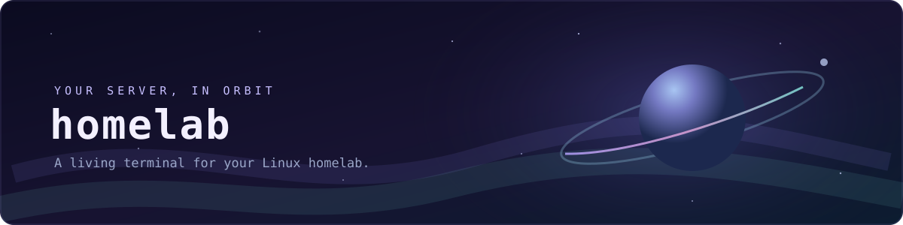
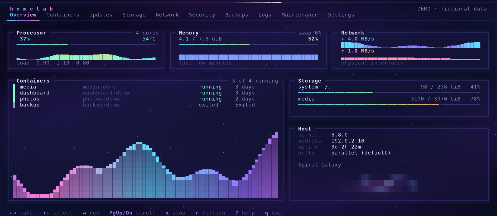

<p align="center">
  
</p>

<p align="center">
  <strong>Your homelab at a glance. Your tools a keystroke away.</strong><br>
  A Linux terminal dashboard for Docker, system telemetry, and day-to-day maintenance,
  set against a slowly moving night sky.
</p>

<p align="center">
  <a href="#get-started">Get started</a> ·
  <a href="#make-it-yours">Configure</a> ·
  <a href="#keyboard">Keyboard</a> ·
  <a href="#before-running-operations">Operation safety</a>
</p>

---

HomeLab TUI brings the pieces of a self-hosted server together in one SSH-friendly terminal. Follow the health of a host, inspect containers, find logs, and run maintenance tasks without leaving your shell. Ten individually themed tabs add a little space to the experience; the dashboard remains usable with animation turned off.



<p align="center"><em>Rendered from the built-in demo; all displayed data is fictional.</em></p>

| Explore | What you'll find |
| --- | --- |
| **Overview** | CPU, memory, network, disk usage, and container status. |
| **Containers** | Live Docker container states and actions for a selected container. |
| **Updates** | Compose checks and options for system or eligible running-service updates. |
| **Storage · Network · Security** | Host diagnostics and checks, subject to the tools and permissions installed on your system. |
| **Backups · Logs · Maintenance** | Explicitly invoked backup, logging, reporting, and maintenance commands. |
| **Settings** | Animation, polling, update pacing, and help. |

The interface is a real terminal application, not a web service. Live status comes from your host and Docker; availability depends on your environment and permissions. **Demo mode uses fictional telemetry** and is intended for trying the interface without operating a server.

## Get started

### Requirements

- A **Linux** host with an interactive UTF-8 terminal. The TUI uses Linux `/proc` and terminal APIs; it is not a native Windows or macOS application. You can connect to your Linux server over SSH from either platform.
- Go **1.22 or later** to build from source.
- A terminal window of at least **96 columns × 28 rows**. A larger window gives the scenes room to breathe. True-color support is recommended.
- Docker and the Docker Compose plugin for Docker and Compose features. Host telemetry can still be useful without Docker.

Some diagnostics need additional system tools. Ubuntu/Debian package actions use APT; on other distributions those actions are not applicable. Access to Docker is powerful: anyone able to control its daemon can generally gain root-equivalent control of the host. Use a trusted account and environment.

### Build and preview

Clone the repository and build it on your Linux host:

```sh
git clone https://github.com/fahaddubush/homelab-tui.git
cd homelab-tui
go build -o homelab .
./homelab --demo
```

Press `q` to exit. Demo values are simulated; they do not describe your server. Actions are disabled in demo mode.

### Run against your host

```sh
./homelab
```

The default launch does not request a sudo password. To explicitly authenticate before entering the dashboard for actions that need elevated access, run `./homelab --sudo`; you can also rely on an already valid sudo session. Without the necessary permissions, privileged operations fail rather than elevating themselves.

To make the command available in future shell sessions, install it into a directory on your `PATH`:

```sh
install -Dm755 ./homelab "$HOME/.local/bin/homelab"
homelab
```

If `homelab` is not found, add `$HOME/.local/bin` to your shell's `PATH`, then start a new shell. You can also run it by its full path. `./homelab --help` shows the available startup options and config location.

## Make it yours

HomeLab reads configuration from `$XDG_CONFIG_HOME/homelab/config.json`, or `~/.config/homelab/config.json` when `XDG_CONFIG_HOME` is unset. The container list shows the Docker host's containers; Compose operations use the configured project.

For Compose discovery, it checks the current directory, `~/arr`, `~/homelab`, then `/opt/arr` for a conventional Compose filename. If a directory contains more than one candidate, discovery stops instead of guessing. Set `HOMELAB_COMPOSE_FILE` to select one, or set `compose_file` in the JSON configuration; an explicit JSON value takes precedence over the environment variable and discovery. For example:

```sh
HOMELAB_COMPOSE_FILE="$HOME/my-project/compose.yaml" homelab
```

Media discovery checks common locations such as `~/media`, `/mnt/media`, and `/srv/media`. Set explicit paths when your layout differs.

Example configuration (replace **every** path with an absolute path on your own machine):

```json
{
  "arr_dir": "/absolute/path/to/your/project",
  "compose_file": "/absolute/path/to/your/project/compose.yaml",
  "media_dir": "/absolute/path/to/your/media",
  "backup_dir": "/absolute/path/to/your/backups",
  "report_dir": "/absolute/path/to/your/reports",
  "animations": true,
  "refresh_seconds": 5,
  "pull_pause_seconds": 8
}
```

Create the directory before saving the file. Paths in JSON are literal: use absolute paths rather than `~` or `$HOME`. The dashboard can save supported settings from its Settings tab. Keep your local config out of shared repositories—it may reveal private paths.

## Keyboard

| Key | Action |
| --- | --- |
| `←` `→` or `Tab` | Switch tabs |
| `1`–`9`, `0` | Jump to a tab |
| `↑` `↓` or `j` `k` | Move selection |
| `Enter` | Open an action or run the selected item |
| `Page Up` / `Page Down` | Scroll task output |
| `r` | Refresh status |
| `x` | Request a running task to stop at its safe point |
| `?` | Open the keyboard guide |
| `q` | Quit |

## Before running operations

HomeLab includes actions that can **change the real machine**: containers can be stopped or recreated; packages can be upgraded or removed; backups and reports can be written; Docker cleanup and host power actions can have broad effects. Review the selected action and its confirmation in the context of your own setup. Some actions depend on `sudo` or tools not installed on every system.

The stack updater is designed to skip services that are stopped, missing, or scaled when it checks them. Docker Compose cannot atomically check a container's state and recreate it, so a service stopped concurrently between the final check and recreation could still be started. Avoid stopping or changing services while an update is running. Recreating a running container also interrupts that service.

**Update everything** includes a system package upgrade as well as container updates. Package changes can restart Docker or other system services, so they can affect containers independently of the TUI's running-service checks. Review your backup and maintenance practices before running it. Updating an image is not a substitute for an application-level backup.

## Troubleshooting

- **The window is too small:** expand it to at least 96 × 28; on a phone, use a smaller font or landscape orientation.
- **Docker is unavailable:** check that the daemon is running and that your user has the intended Docker permissions. The TUI cannot grant those permissions.
- **A Compose action cannot find your project:** set `compose_file` to the correct absolute path and verify that `docker compose -f /path/to/compose.yaml config --services` succeeds for your user.
- **More than one Compose file is present:** automatic discovery refuses to guess. Set `HOMELAB_COMPOSE_FILE` or the JSON `compose_file` explicitly.
- **Motion or color is distracting:** switch animations off in Settings. Terminal font, Unicode glyph support, and color settings can affect the appearance.
- **A diagnostic is missing or denied:** install the relevant host utility or configure access according to your system's policies. Not every tool exists on every Linux distribution.

## License

[MIT](LICENSE)

---

Made for people who like their server dashboards a little more cosmic.
